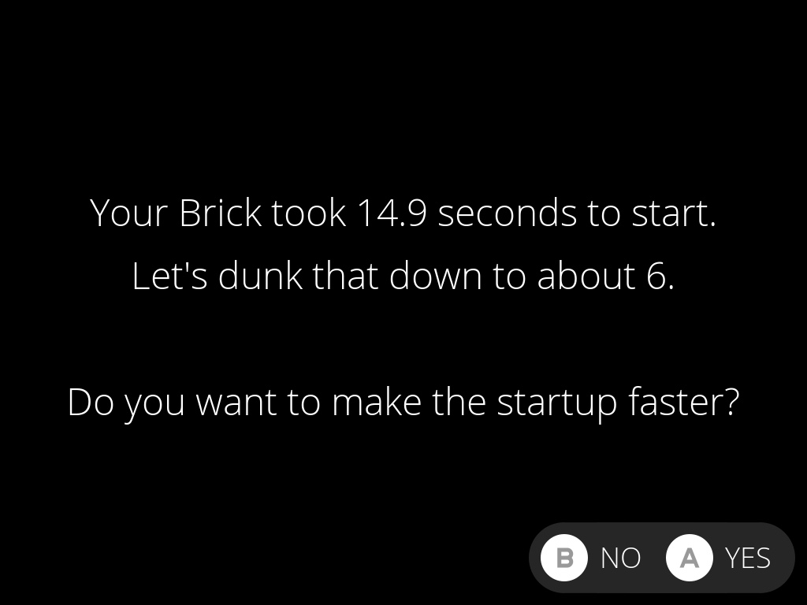
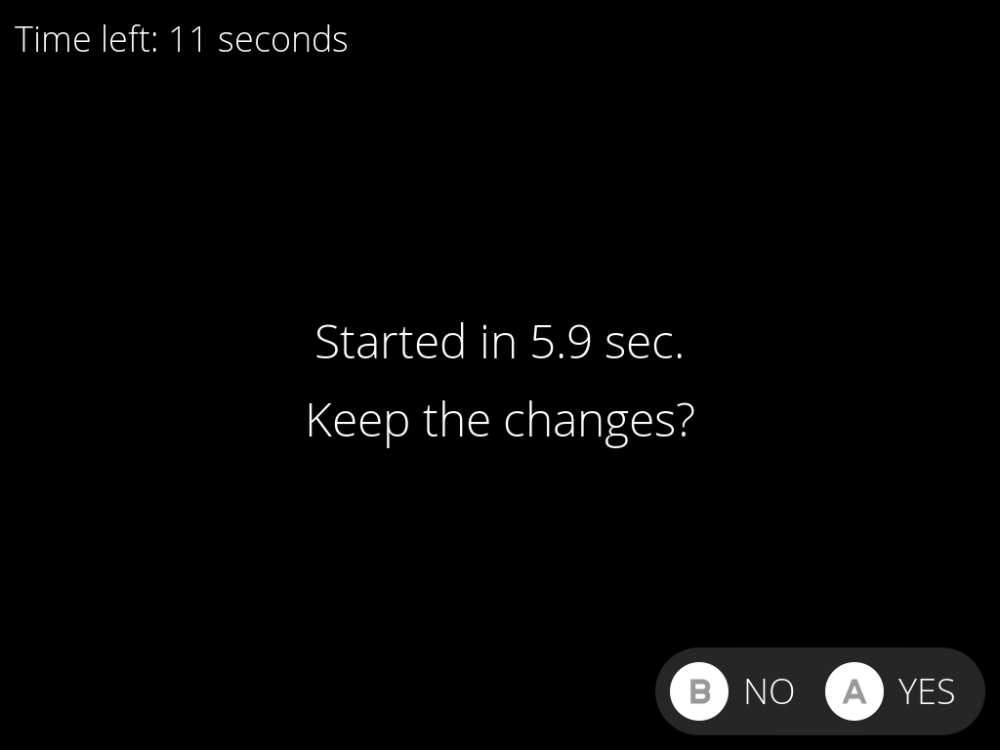
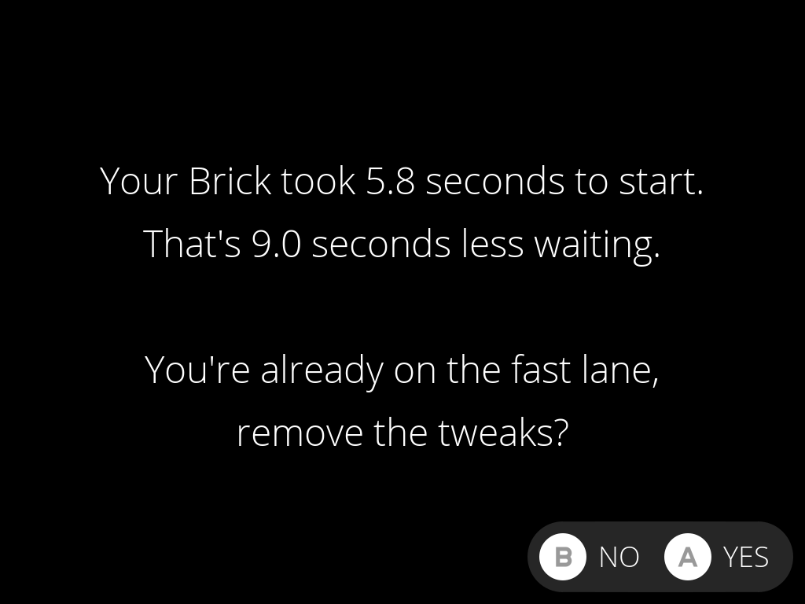

# Startup Speeder Upper

Makes the TrimUI Brick, Brick Hammer and Brick Pro start in under 6 seconds
instead of 15. One button to speed up, one button to undo.

| Before | After |
|---|---|
| 14.9 s | 5.8 s |

## Install

Find it in Pak Store under System. Or copy
`Startup.Speeder.Upper.pakz` from the
[latest release](https://github.com/pvaibhav/nextui-startup-speeder-upper-pak/releases/latest)
to the SD card's root and restart.

## Use

1. Open Startup Speeder Upper in **Tools** and press **A**.
2. The Brick restarts. Faster.
3. Press **A** at "Keep the changes?".

**B**, or no answer for 15 seconds, puts everything back and restarts.

There is a slight chance one of the tweaks garbles your Brick's screen, it's
harmless, but if you can't see nothing we'll undo the changes after waiting a
bit.

Open the tool again to see the seconds you're saving, or to go back to the
slow lane.

## Needs

- A Brick, Brick Hammer or Brick Pro on TrimUI firmware 1.1.1. Anything else
  gets a polite no.
- NextUI with startup hooks.

## What the Brick stops doing

- Waiting for a computer's flashing tool that isn't there.
- Printing boot messages to a serial port nobody's listening to.
- Napping for up to 250 ms at a time while switching on the screen.
- Setting up 16 RAM disks. It gets one.
- Loading 21 MB of GPU driver debug data.
- Reading TrimUI's 2 MB menu program just to learn its own model name.
- Waiting for a hotplug event before mounting the SD card.

TrimUI's backup copies of the bootloader are never touched. Details and
safety nets: [docs/how-it-works.md](docs/how-it-works.md).

## Credits

The tweaks come from boot research for [BaseOS](https://github.com/pvaibhav/BaseOS),
which starts Anbernic handhelds in about 4 seconds.

The dialogs are [minui-presenter](https://github.com/josegonzalez/minui-presenter)
by Jose Diaz-Gonzalez.

## Building

`tools/build.sh` writes `dist/Startup.Speeder.Upper.pakz`. A tag matching
the version in `pak.json` publishes a release.

[MIT License](LICENSE). Third-party files: [THIRD-PARTY.md](THIRD-PARTY.md).
